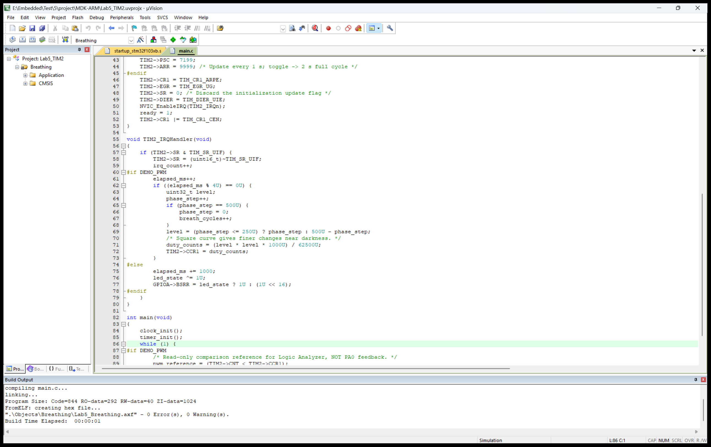

# STM32 定时器与 PWM：从 LED 定时闪烁到呼吸灯（Keil 仿真）

前面的实验已经接触过 GPIO，这次继续用 LED 来理解定时器。先让它按固定节奏亮灭，再把“开”和“关”的时间分得更细，就能用 PWM 调整平均亮度，做出呼吸灯。

这次只做代码和 Keil 软件仿真，没有连接开发板。下面把工程配置、参数计算和调试过程一起记录下来；涉及波形时，也会区分固件运行结果与引脚输出验证。

## 一、先把定时器的几个参数弄清楚

定时器可以理解为一个按时钟节拍递增的计数器。PSC 先把输入时钟分频，CNT 再按分频后的节拍计数，数到 ARR 后重新开始。向上计数时，更新时间可以写成：

`T = (PSC + 1) × (ARR + 1) / fTIM`

这里两个“加一”都不能漏。比如 ARR 写 999，实际经历的是 0～999，一共 1000 个计数。

PWM 在这个基础上增加了比较寄存器 CCR。采用 PWM1、高电平有效时，CNT 小于 CCR1 的阶段输出有效电平。ARR 和 PSC 不变，只调整 CCR1，就能在频率不变的情况下改变占空比。

## 二、建立工程，确定使用的引脚

这次选 STM32F103C8，使用 TIM2 的通道 1，对应默认映射的 PA0。要注意，常见最小系统板上的 PC13 LED 不能直接当作这个通道的 PWM 输出；如果以后上板，需要给 PA0 单独接一个带限流电阻的 LED。另外，C8 型号并没有 TIM5，所以这里直接选择 TIM2。

工程保存在 `project`，截图放在同级的 `picture`。Keil 工程中设置了 Blink 和 Breathing 两个目标，切换目标就能编译对应实验，代码仍然放在同一个 main.c 中。


参考文章主要通过 CubeMX 和 HAL 库完成配置。本次采用 CMSIS 寄存器写法，把时钟、GPIO 和定时器配置直接放在代码里，方便在调试器中逐项对应。没有生成 CubeMX 工程，也没有额外添加与本实验无关的串口测频功能。

时钟使用 8 MHz 外部晶振模型，经 PLL 倍频到 72 MHz。APB1 分频为 2，虽然总线是 36 MHz，但 TIM2 的计数时钟需要按 72 MHz 计算。

## 三、先完成两秒亮灭

题目中“2s 的频率”更准确的说法应当是周期。这里按完整亮灭周期 2 秒理解，也就是亮 1 秒、灭 1 秒。因此定时器应该每秒触发一次中断，而不是每两秒翻转一次。

将 PSC 设为 7199、ARR 设为 9999，代入公式就得到 1 秒的更新间隔。中断里只需要翻转状态，并把新的状态写到 PA0：

```c
led_state ^= 1U;
GPIOA->BSRR = led_state ? 1U : (1U << 16);
```

这里 PA0 先配置成普通推挽输出，由 TIM2 更新中断控制亮灭。启动之前还要清除初始化时产生的更新标志，否则可能一开定时器就多进一次中断。

进入 Keil 仿真后，运行随工程提供的 lab_check()。日志中，约 1.01 秒时 PA0 为 0，约 2.01 秒时恢复为 1，随后继续交替。中断计数也每秒增加一次，与参数计算一致。


## 四、把开关变成渐亮渐灭

呼吸灯仍然用 PA0，不过这次将 GPIO 改成复用推挽输出，把引脚控制权交给 TIM2_CH1。PWM 使用向上计数、PWM1 和高电平有效，PSC=71、ARR=999，因此 PWM 的周期是 1 ms，也就是 1 kHz。

PWM 本身的周期和呼吸周期是两回事。前者决定脉冲有多快，后者决定亮度包络多久重复。程序每 4 ms 调整一次比较值，先用 250 步渐亮，再用 250 步渐灭，完整过程就是 2 秒。

为了让低亮度部分的变化更细一点，这里没有直接把步数线性写入 CCR，而是用了平方曲线：

```c
level = (phase_step <= 250U) ? phase_step : 500U - phase_step;
duty_counts = (level * level * 1000U) / 62500U;
TIM2->CCR1 = duty_counts;
```

这样 CCR1 在 0～1000 之间变化。ARR 虽然是 999，但 CCR1 可以写 1000，此时整个计数周期都满足 CNT 小于 CCR1，对应 100% 占空比。这个效果只从占空比曲线进行了检查，实际 LED 的视觉感受还需要以后上板再调整。



## 五、仿真时该看什么

在 Debug 中选择 Use Simulator，进入调试后打开 Logic Analyzer。观察呼吸节奏时，把 duty_counts 的纵轴设为 0～1000，并把时间范围拉到几秒；检查单个脉冲时，再缩小到毫秒范围。

日志里约 0.51 秒和 2.51 秒处的 CCR1 都是 258，约 1.01 秒和 3.01 秒处都是 984，呼吸次数也每两秒增加一次。这比仅凭曲线“看起来像呼吸灯”更容易确认周期是否正确。


调试中还遇到了一个需要单独说明的现象：本机 Keil 中，PWM 配置和 CCR1 更新正常，但 `(PORTA & 1)` 没有显示复用 PWM 的跳变。因此这部分不能写成“PA0 输出已实测通过”。工程另设 pwm_reference，由主循环读取 CNT 和 CCR1 后形成比较参考，方便理解脉冲宽度如何变化。它不是 PA0 回读，采样也会受到指令执行、中断及 CCR 预装载生效时刻的影响。

这次已经完成定时中断、PWM 参数和呼吸节奏的代码仿真；PA0 复用输出波形仍属于当前环境没有完成直接验证的部分。没有使用脚本向 PA0 写入人为方波来代替验证。


缩小时间窗口后，参考脉冲每隔约 1 ms 重复一次，当前占空比约为四分之一。这张图用来解释 PWM 比较关系，不作为外部引脚输出通过的证据。

## 六、做完后的几点体会

这次最容易混淆的地方其实是时间：更新中断的 1 秒、LED 完整亮灭的 2 秒、PWM 脉冲的 1 毫秒，以及呼吸包络的 2 秒，都有各自的含义。把它们分开算，再去看寄存器和波形，调试就清楚很多。

另一个收获是，仿真结果需要说明观察对象。CCR 的变化可以证明程序在调整占空比，但还不能直接等同于外部引脚已经输出正确。把这些边界记下来，也方便之后换仿真环境或接开发板继续验证。

工程仓库：https://github.com/Gallagher1201/stm32-tim2-pwm-lab5

## 参考文章

- [STM32CubeMX & Keil——STM32F103C8T6：PWM控制LED灯](https://blog.csdn.net/Morzart/article/details/134123197)
- [定时器中断、PWM 呼吸灯及输入捕获](https://blog.csdn.net/Xkccsdn147/article/details/134191212)
- [STM32 定时器与 PWM 实验](https://blog.csdn.net/weixin_52345779/article/details/135313203)

本文按本次工程和实际仿真过程整理，参考文章用于理解配置思路。当前为草稿，未公开发布。
