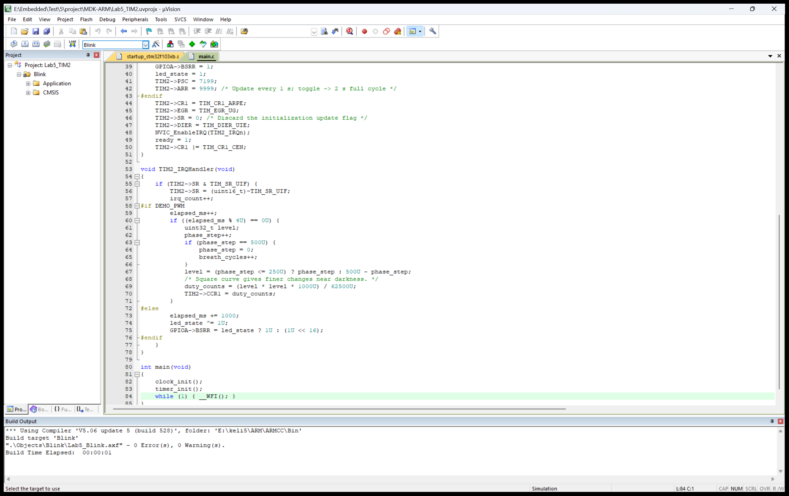
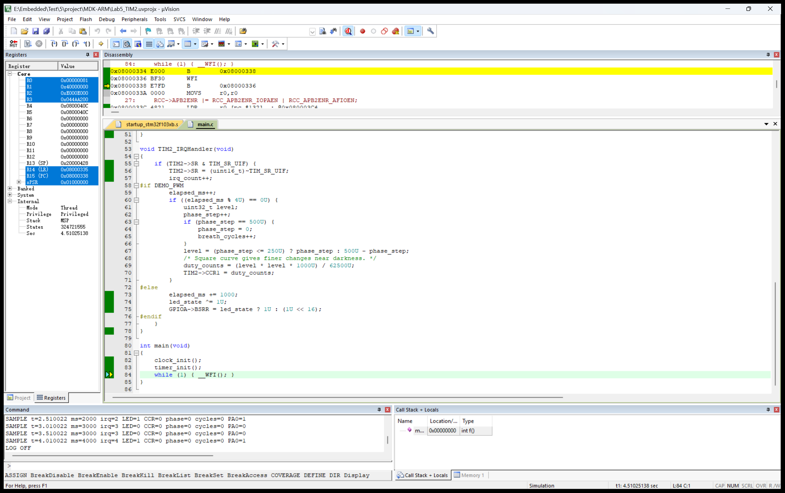
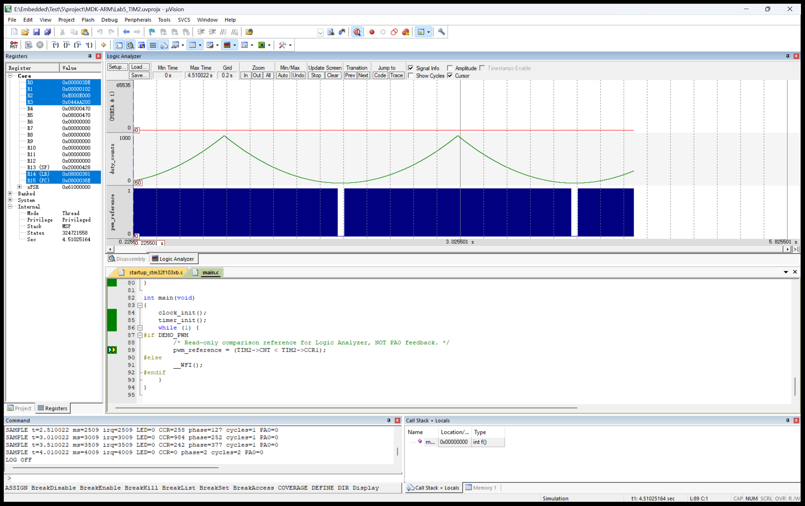
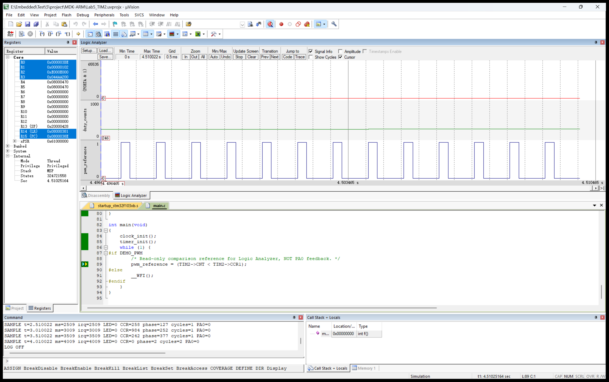

# STM32 定时器与 PWM 实验报告

实验日期：2026 年 10 月 20 日

作者标识：LilGallagher / Gallagher1201

验证方式：Keil 软件仿真，未连接开发板

## 一、实验目的

理解 STM32 通用定时器的时钟、预分频和计数过程，掌握更新中断与 PWM 输出配置，能够根据周期要求计算 PSC、ARR 和 CCR，并在 Keil 中观察软件状态和比较参考波形。

## 二、实验内容与环境

实验一通过 TIM2 计数更新中断控制 PA0，使输出亮 1 秒、灭 1 秒，完整周期为 2 秒。实验二使用同一引脚的 TIM2_CH1 复用功能，配置 PWM1 模式，以 2 秒为一个呼吸周期改变占空比。

使用 STM32F103C8 器件模型、Keil μVision 和 ARM Compiler 5.06 update 5，芯片包为 STM32F1xx_DFP 2.2.0。工程采用 CMSIS 寄存器编程，包含启动文件、系统时钟文件及本地芯片头文件。本次没有执行 CubeMX 生成、烧录和上板测试。

PA0 是 TIM2_CH1 默认映射引脚。若后续连接实物，设计接法为 PA0 经约 330 Ω 限流电阻连接 LED 阳极，阴极接 GND。板载 PC13 LED 不属于该通道。STM32F103C8 不具有 TIM5，本实验选择 TIM2。

## 三、原理与参数设计

外部时钟模型为 8 MHz，PLL 倍频 9，系统时钟为 72 MHz。APB1 分频系数为 2，总线频率为 36 MHz；此时 TIM2 内核时钟为 APB1 时钟的两倍，即 72 MHz。

向上计数时，更新时间 T=(PSC+1)×(ARR+1)/fTIM。PWM1、高电平有效时，占空比 D=CCR1/(ARR+1)。计数器从 0 到 ARR，因此计算中必须保留“加一”。

|项目|Blink|Breathing|
|---|---|---|
|PSC / ARR|7199 / 9999|71 / 999|
|更新间隔|1 s|1 ms|
|PA0 配置|普通推挽输出|复用推挽输出|
|完整效果周期|2 s|2 s|

Blink 每次更新中断翻转一次 GPIO，两个中断构成完整亮灭周期。Breathing 的 PWM 频率为 1 kHz，每 4 次更新中断调整一次比较值，共 500 步构成 2 秒周期。

呼吸包络的线性步数先从 0 增加到 250，再降低到 0；比较值采用 level²×1000/62500 的整数计算。这样在低占空比阶段变化更细，最大值 1000 对应 100% 占空比。视觉舒适程度未通过实物验证。

## 四、实现过程

在指定目录建立 project、picture 和 report。工程设置 Blink 与 Breathing 两个目标，通过 DEMO_PWM 宏选择运行分支。两个目标共用 main.c，避免两套代码重复维护。



初始化时依次配置时钟、GPIO、定时器和 NVIC。通过 EGR 产生更新事件装载 PSC 后清除 SR，避免初始化更新事件被误认为第一次定时到期。打开更新中断后再使能计数器。

Blink 中断通过 led_state 翻转 PA0。Breathing 配置 CCMR1 的 PWM1 与 CCR1 预装载，使能 CC1E；更新中断累计毫秒数，每 4 ms 计算一次新的 duty_counts 并写入 CCR1。

核心占空比计算如下，完整工程随附件提供：

```c
level = (phase_step <= 250U) ? phase_step : 500U - phase_step;
duty_counts = (level * level * 1000U) / 62500U;
TIM2->CCR1 = duty_counts;
```

## 五、仿真方法与结果

Debug 选择 Use Simulator，使用 SARMCM3.DLL（-REMAP）和 DARMSTM.DLL（-pSTM32F103C8），初始化文件为 Simulation.ini。进入仿真后运行 lab_check() 和 g，脚本按 0.5 s 间隔记录寄存器及变量，约 4.51 s 后停止。该脚本不写 PA0，不生成激励方波。

### 5.1 定时亮灭

Blink 日志显示约 1.01 s 时 irq_count=1、PA0=0；约 2.01 s 时 irq_count=2、PA0=1；约 3.01 s 与 4.01 s 又重复相同变化。因此 PA0 每秒翻转一次，完整周期为 2 s。与设计值一致。



### 5.2 呼吸包络

Breathing 仿真中读到 PSC=71、ARR=999、CCMR1=0x68、CCER=0x1，GPIOA_CRL=0x4444444B，表明 PA0 配置为复用推挽输出、通道采用 PWM1 并使能。

约 0.51 s 与 2.51 s 的 CCR1 均为 258，约 1.01 s 与 3.01 s 的 CCR1 均为 984。breath_cycles 在 2 s 与 4 s 附近分别增加至 1 与 2，证明呼吸包络周期为 2 s。采样点不恰好位于峰值，因此日志中的 984 不能误写成程序最大占空比；代码最大比较值为 1000。



### 5.3 比较参考与验证限制

当前 Keil 环境中，PWM 模式下 PORTA 的 PA0 位未显示跳变。本次未直接验证到该引脚的复用输出波形，不能把软件状态验证等同于引脚输出验证。为观察比较原理，主循环将 CNT 与 CCR1 的大小关系记录到 pwm_reference，再通过 Logic Analyzer 展示。



图中参考脉冲约每 1 ms 重复，所示片段占空比约 25%，与 CCR1 约 250 相符。pwm_reference 不是 GPIO 输入回读，也不是外设内部 OC1REF 的直接测量。主循环采样存在指令和中断延迟；CCR1 预装载更新附近，读取值也未必等于当时生效的影子值。因此该图只作为比较参考，不能用于精密测量硬件边沿。

## 六、问题分析与总结

第一，实验中的“2s”按完整周期处理，翻转间隔应为 1 s。第二，定时器输入时钟不能直接取 APB1 的 36 MHz。第三，PWM 的 1 ms 周期与呼吸包络的 2 s 周期必须分开计算。第四，PWM 比较值取 ARR+1 可以实现 100% 占空比。

本次完成了两种目标的编译、定时更新中断仿真、占空比包络仿真和比较参考波形观察。Blink 的 PA0 翻转已在模拟器中观察到；Breathing 的寄存器与软件周期已验证，但 PA0 复用输出未完成直接波形验证。没有进行烧录，也没有声称观察到真实 LED 的亮度变化。后续可在支持该外设输出的模型或开发板上补充引脚验证。

## 七、附件与参考资料

工程：project/MDK-ARM/Lab5_TIM2.uvprojx。截图：picture。博文草稿与报告：report。仿真原始记录：project/MDK-ARM/Blink_Simulation.log 和 Breathing_Simulation.log。

GitHub：https://github.com/Gallagher1201/stm32-tim2-pwm-lab5

CSDN 作者主页：https://blog.csdn.net/LilGallagher 。博文保存为草稿，尚无公开文章地址。

参考文献：

1. Morzart，STM32CubeMX & Keil——STM32F103C8T6：PWM控制LED灯，https://blog.csdn.net/Morzart/article/details/134123197。
2. Xkccsdn147，定时器中断与 PWM 实验，https://blog.csdn.net/Xkccsdn147/article/details/134191212。
3. weixin_52345779，STM32 定时器及 PWM 实验，https://blog.csdn.net/weixin_52345779/article/details/135313203。
